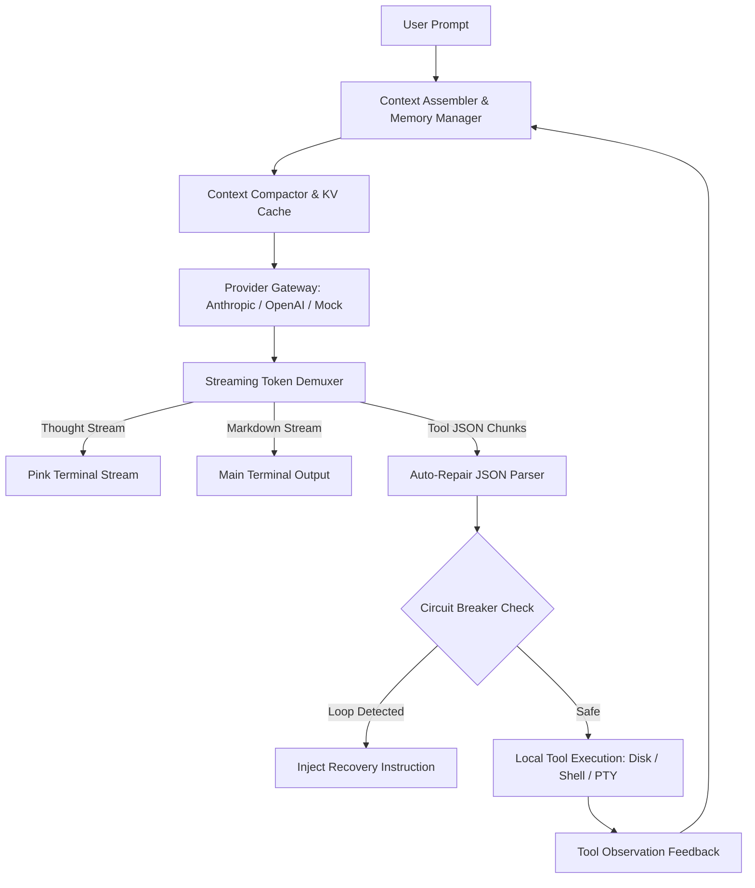

# 🧠 Mini-Inference

An educational **Agent Inference & Reasoning Engine** reverse-engineered from the architecture of modern autonomous coding agents like [OpenCode](https://github.com/anomalyco/opencode) and Claude Code.

---

## 🎯 What Problem Does This Solve?

Most developers assume building an AI coding assistant is just calling `openai.chat.completions.create()`. In reality, production agents hit 5 massive engineering bottlenecks:
1. **The Streaming Demuxing Problem:** Separating extended thinking (`<thought>`), conversational text, and streaming tool calls without freezing the UI.
2. **The Malformed Tool Call Problem:** Handling and auto-repairing malformed JSON generated by LLMs (e.g. trailing commas, missing closing brackets).
3. **The Exponential Token & Cost Problem:** Leveraging KV-Cache (Prompt Caching) to avoid re-computing prompt prefixes.
4. **The Context Window Overflow Problem:** Active context compaction that prunes old verbose tool outputs and folds older conversation turns into structured checkpoints.
5. **The Infinite Hallucination Loop Problem:** A circuit breaker detecting when the model repeatedly retries identical failed commands.

`mini-inference` implements these five systems cleanly in TypeScript / Bun with zero external framework dependencies.

---

## 🏗️ Architecture



---

## 📂 Project Structure

```text
mini-inference/
├── src/
│   ├── types.ts         # Unified message schemas, tool definitions, and streaming events
│   ├── json-repair.ts   # Auto-repairing tolerant JSON parser for broken LLM outputs
│   ├── demuxer.ts       # Real-time token demuxer (thought vs text vs tool call)
│   ├── compactor.ts     # Context compaction & memory sliding-window manager
│   ├── loop-breaker.ts  # Circuit breaker preventing repetitive tool execution loops
│   ├── providers.ts     # Multi-provider adapter + educational multi-turn simulator
│   ├── engine.ts        # The core ReAct orchestrator tying the entire engine together
│   └── index.ts         # Interactive CLI demo
├── package.json
├── tsconfig.json
└── README.md
```

---

## 🚀 Quickstart

Run with [Bun](https://bun.sh):

```bash
bun install
bun run src/index.ts
```

---

## 🧪 What You Will See in the Demo

When you run `bun run src/index.ts`, the demo simulates an autonomous agent tasked with fixing an under-provisioned database connection pool:
1. **Turn 1 (Inspect):** Streams `<thought>` reasoning tokens, generates a `read_file` tool call with deliberate trailing commas, repairs the JSON on the fly, and reads `src/config.ts`.
2. **Turn 2 (Act & Patch):** Analyzes the file output, realizes `maxPoolSize: 2` is too low, and applies a `write_file` patch setting it to `20`.
3. **Turn 3 (Verify):** Verifies the written file, reports KV-cache metrics (69%+ cache reuse), and reports task completion.

---

## 🤝 Connecting to Your GitHub

To push this repository to your GitHub account:

```bash
# 1. Create a new repository on GitHub named 'mini-inference' (https://github.com/new)
# 2. Add remote and push:
git remote add origin git@github.com:vikranthgaddam/mini-inference.git
git push -u origin main
```
